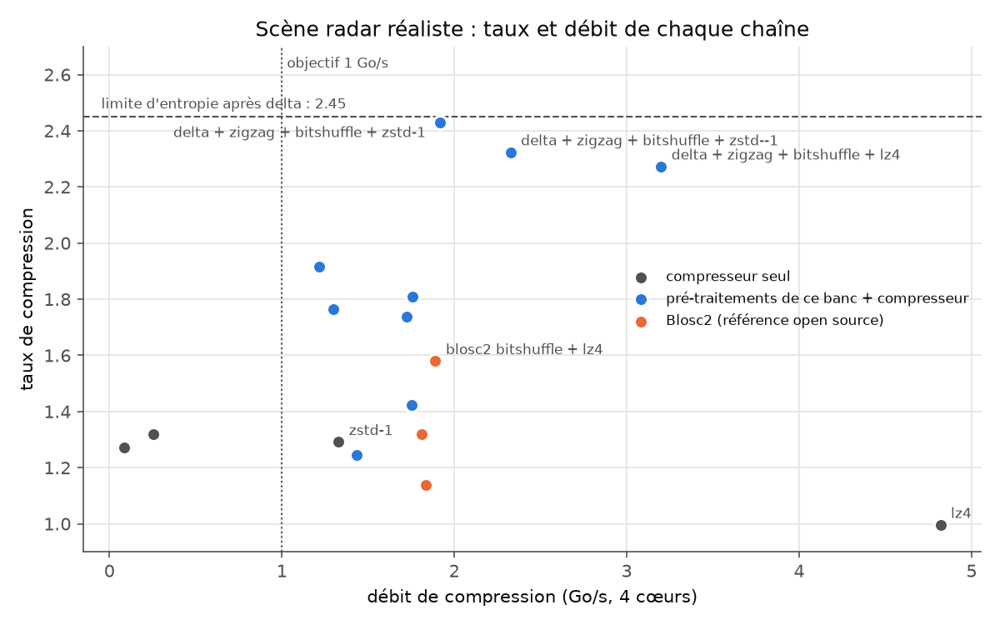
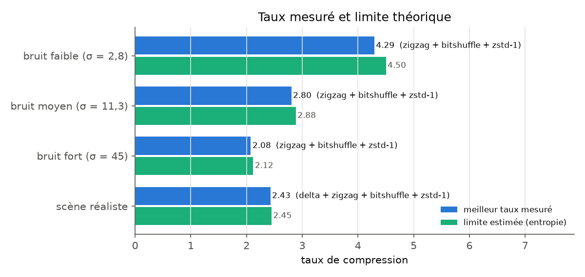
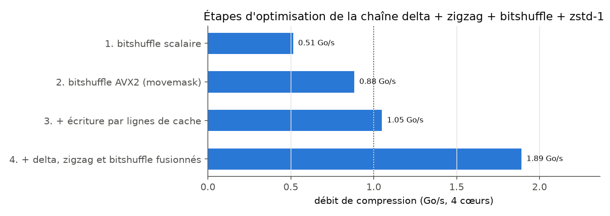
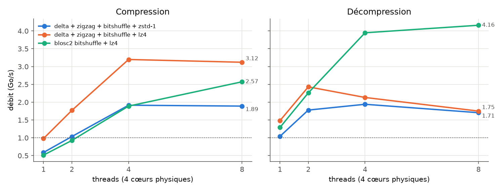
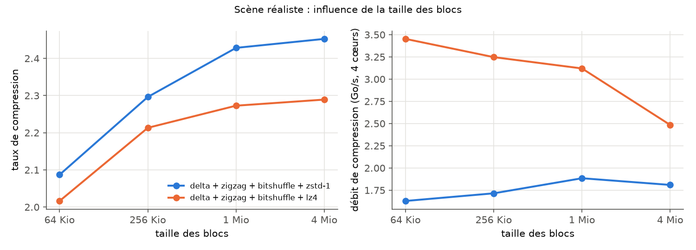

# Compression sans perte de données radar à plus de 1 Go/s

Banc de test en C (OpenMP, AVX2) qui mesure le **taux de compression** et le **débit** de chaînes
« pré-traitements + compresseur » sur des échantillons radar I/Q bruts, vérifie que chaque
décompression redonne les données **octet par octet**, et compare le résultat à la **limite
théorique** donnée par l'entropie du signal.

## Résultats principaux

Données synthétiques I/Q, convertisseur 14 bits stocké sur 16 bits, 256 Mio par jeu de données,
blocs indépendants de 1 Mio, Intel Core i5-10310U (4 cœurs), 4 threads.

- **Scène réaliste (bruit + fouillis de sol + cibles)** : taux de **2,43 à 1,89 Go/s** avec
  `delta + zigzag + bitshuffle + zstd-1`, soit 99 % de la limite estimée (2,45). Pour le débit :
  taux de 2,27 à **3,2 Go/s** avec LZ4.
- **Bruit pur** (le pire cas) : 95 à 98 % de la limite d'entropie, à 1,4 à 1,8 Go/s.
- **Par rapport à Blosc2**, la référence open source (bitshuffle + LZ4) : taux de 2,27 contre 1,58
  sur la scène, et 3,2 Go/s contre 1,9 Go/s, grâce à un pré-traitement adapté à la structure
  d'un signal radar (différence d'une impulsion à l'autre).
- **Débit multiplié par 3,7** sur la chaîne principale, de 0,51 à 1,89 Go/s, en quatre étapes
  d'optimisation guidées par la mesure (`perf`) : vectorisation AVX2, puis correction de conflits
  de cache, puis fusion des pré-traitements.



## Pourquoi un signal radar se compresse mal, et jusqu'où on peut aller

Un signal radar brut est dominé par le **bruit thermique**, et un bruit aléatoire ne se compresse
pas sans perte au-delà de son **entropie**. Pour un bruit gaussien d'écart-type σ (en unités du bit
de poids faible), l'entropie vaut environ log₂(σ·√(2πe)) bits par échantillon : le taux maximal est
16 / H. `entropy.py` calcule cette limite avant tout essai de compresseur :

| Données | σ par voie | Entropie théorique | Entropie mesurée | Taux maximal |
|---|---|---|---|---|
| Bruit faible | 2,8 | 3,547 bits | 3,554 bits | 4,50 |
| Bruit moyen | 11,3 | 5,547 bits | 5,547 bits | 2,88 |
| Bruit fort | 45 | 7,547 bits | 7,547 bits | 2,12 |
| Scène réaliste | 11,3 | | 10,41 bits, **6,53 après delta** | 1,54, **2,45 après delta** |

Deux leviers en découlent :

1. **Les bits de poids fort sont prévisibles** : un convertisseur 14 bits sur 16 bits, et un bruit
   qui n'occupe que quelques bits faibles. Le *bitshuffle* range ensemble les bits de même rang :
   les plans de poids fort deviennent de longues suites de 0 que le compresseur élimine.
   Le *zigzag* transforme les petits nombres négatifs (0xFFFE...) en petits nombres positifs, dont
   les bits forts sont aussi à 0.
2. **Le fouillis de sol se répète d'une impulsion à l'autre** : soustraire l'impulsion précédente
   (*delta*) le fait disparaître. Sur du bruit pur, le delta ajoute au contraire 0,5 bit
   (la variance double) : il faut l'utiliser seulement si le signal a cette structure.

Pour le bruit pur, la limite est exacte (source sans mémoire). Pour la scène, l'entropie après
delta n'est qu'une estimation : avec des blocs de 4 Mio, Zstd la dépasse très légèrement (2,4525),
car il exploite des corrélations restantes.



## Le banc de test

- `gen_radar.py` : 4 jeux de données de 256 Mio. Bruit gaussien complexe ; fouillis fort aux courtes
  distances, quasi stable d'une impulsion à l'autre ; 3 cibles avec un décalage Doppler ;
  quantification 14 bits avec saturation (0,09 % des échantillons de la scène).
- `src/filters.c` : pré-traitements réversibles (delta, zigzag, byte shuffle, bitshuffle), en C
  portable et en AVX2.
- `src/bench.c` : données lues en mémoire (on mesure le compresseur, pas le disque), découpées en
  blocs indépendants compressés en parallèle (OpenMP), meilleur temps sur 3 essais, **vérification
  octet par octet** de chaque décompression. Compresseurs : LZ4, Zstd (niveaux -1, 1, 3), zlib,
  et Blosc2 comme référence.
- `tests/test_filters.c` : 2 341 tests d'aller-retour (tailles 0 à 524 288, cas de dépassement),
  et comparaison des versions AVX2 et scalaire à une version bit par bit évidente.

### Résultats par jeu de données (4 threads, blocs de 1 Mio)

| Données | Chaîne | Taux | Compression | Décompression |
|---|---|---|---|---|
| Scène réaliste | lz4 seul | 1,00 | 4,82 Go/s | 5,04 Go/s |
| | zstd-1 seul | 1,29 | 1,33 Go/s | 2,57 Go/s |
| | Blosc2 bitshuffle + lz4 | 1,58 | 1,89 Go/s | 3,95 Go/s |
| | **delta + zigzag + bitshuffle + lz4** | **2,27** | **3,20 Go/s** | 2,13 Go/s |
| | **delta + zigzag + bitshuffle + zstd-1** | **2,43** | **1,92 Go/s** | 1,94 Go/s |
| Bruit moyen | Blosc2 bitshuffle + lz4 | 2,37 | 2,62 Go/s | 3,94 Go/s |
| | **zigzag + bitshuffle + zstd-1** | **2,80** | 1,41 Go/s | 1,65 Go/s |
| Bruit faible | **zigzag + bitshuffle + zstd-1** | **4,30** | 1,78 Go/s | 2,06 Go/s |
| Bruit fort | **zigzag + bitshuffle + zstd-1** | **2,08** | 1,63 Go/s | 1,85 Go/s |

Toutes les mesures, de 1 à 8 threads : `results/bench.csv`. Machine, compilateur et versions des
bibliothèques : `results/machine.txt`.

## Optimisation : de 0,51 à 1,89 Go/s



| Étape | 1 thread | 4 threads | Ce qui a changé |
|---|---|---|---|
| 1. Bitshuffle scalaire | 0,14 Go/s | 0,51 Go/s | Transposition de matrices de bits 8 x 8 dans un entier de 64 bits |
| 2. Bitshuffle AVX2 | 0,29 Go/s | 0,88 Go/s | `_mm256_movemask_epi8` extrait d'un coup un bit de 32 octets |
| 3. Écriture par lignes de cache | 0,42 Go/s | 1,05 Go/s | Voir ci-dessous |
| 4. Pré-traitements fusionnés | 0,59 Go/s | 1,89 Go/s | Delta, zigzag et bitshuffle en un passage, dans les registres |

**Étape 3, diagnostiquée avec `perf`.** Le bitshuffle AVX2 seul allait à 5,5 Go/s sur un petit bloc,
mais à 0,49 Go/s sur un bloc de 1 Mio. `perf stat` montrait 67 millions de défauts de cache L1 et
une instruction par cycle de 0,36 au lieu de 2,7. Les 16 plans de bits sont espacés d'une puissance
de 2 : leurs adresses tombent dans le même ensemble du cache L1 (8 voies), et chaque écriture de
4 octets chassait une autre ligne. En accumulant 64 octets par plan (une ligne de cache) dans un
tampon local avant de les écrire, les écritures qui ratent le cache passent de 62 à 8,7 millions,
et le débit de 0,49 à 2,09 Go/s.

```bash
perf stat -e cycles,instructions,L1-dcache-load-misses,l2_rqsts.all_rfo ./build/micro_bitshuffle 524288
```

**Étape 4.** Avec 4 threads, les pré-traitements étaient limités par la bande passante mémoire :
les données faisaient trois allers-retours en mémoire (delta, puis zigzag, puis bitshuffle). La
version fusionnée lit l'impulsion courante et la précédente, et n'écrit que les plans de bits :
de 1,27 à 3,11 Go/s pour les pré-traitements seuls.

### Passage à l'échelle et taille des blocs



La compression passe bien à l'échelle jusqu'à 4 cœurs, puis plafonne : l'hyperthreading n'aide pas,
car la mémoire est déjà saturée. La décompression de mes chaînes plafonne plus tôt : le bitunshuffle
et le delta inverse ne sont pas encore fusionnés.



Des blocs plus grands donnent un meilleur taux (le compresseur voit plus de contexte, et seule la
première impulsion de chaque bloc échappe au delta), mais au-delà de 1 Mio le débit baisse (les
tampons ne tiennent plus dans les caches). 1 Mio est un bon compromis sur cette machine.

## Limites et suites

- **Données synthétiques.** Les conclusions sont à confirmer sur des données réelles : niveau de
  bruit, part du fouillis, format des échantillons.
- **Le meilleur pré-traitement dépend du signal** : le delta aide sur le fouillis et pénalise le bruit
  pur. Piste : choisir le pré-traitement bloc par bloc, à partir d'une estimation rapide de l'entropie.
- **Décompression** : fusionner bitunshuffle, zigzag et delta inverse comme à la compression.
- **Machine** : portable 4 cœurs, environ 5 Go/s de bande passante mémoire en copie. Sur un serveur
  avec plus de cœurs et de canaux mémoire, les débits seraient plus élevés.
- **Autres pistes** : AVX-512, compresseurs spécialisés (codage de Rice par plan de bits, FLAC pour
  les signaux), pipeline avec acquisition et écriture disque réelles.

## Reproduire

```bash
sudo apt install liblz4-dev libzstd-dev libblosc2-dev zlib1g-dev cmake
pip install -r requirements.txt

python gen_radar.py 256                 # 4 jeux de données de 256 Mio dans data/
python entropy.py                       # limites théoriques
cmake -S . -B build && cmake --build build -j
ctest --test-dir build                  # 2 341 tests des pré-traitements
./scripts/run_all.sh                    # campagne de mesures (environ 25 min)
python analyse.py                       # figures et tableau de synthèse
```

| Fichier | Rôle |
|---|---|
| `gen_radar.py` | Données I/Q synthétiques (bruit, fouillis, cibles, convertisseur 14 bits) |
| `entropy.py` | Entropie mesurée et théorique, taux maximal |
| `src/filters.c` | Delta, zigzag, byte shuffle, bitshuffle (scalaire et AVX2), version fusionnée |
| `src/bench.c` | Banc de test parallèle avec vérification sans perte |
| `tests/test_filters.c` | Tests d'aller-retour et comparaison à une référence bit par bit |
| `tests/micro_bitshuffle.c` | Micro-benchmark pour `perf stat` |
| `scripts/run_all.sh`, `analyse.py` | Campagne de mesures, figures |
